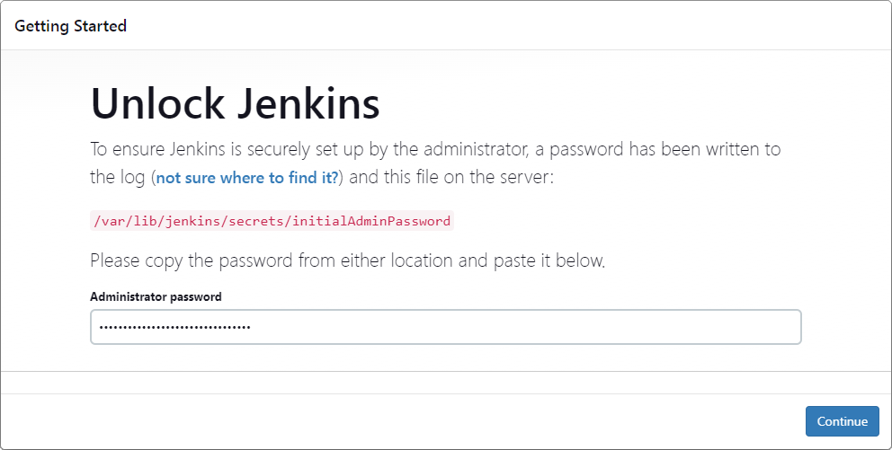
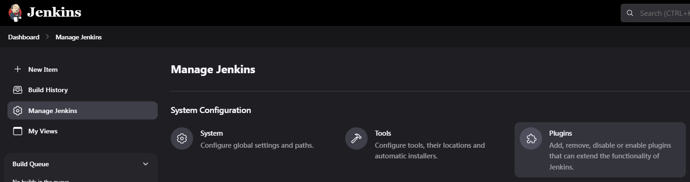
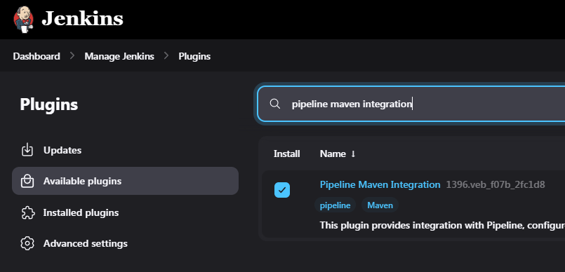
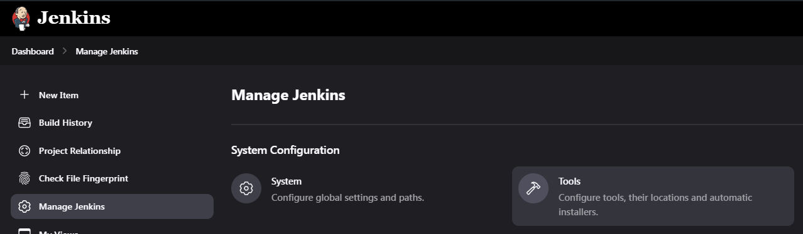
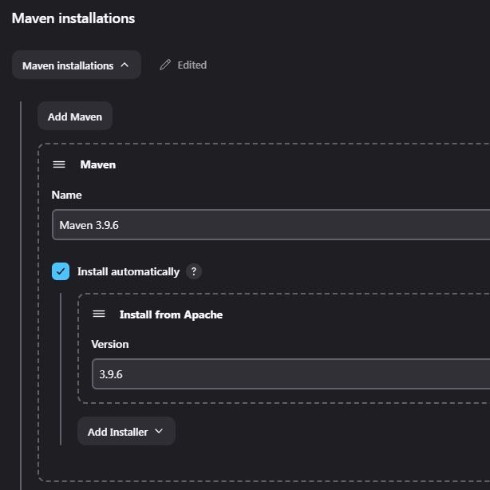
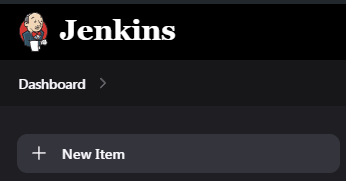
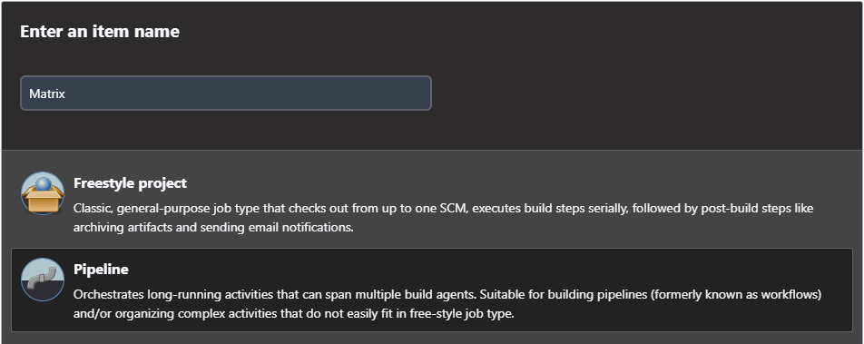
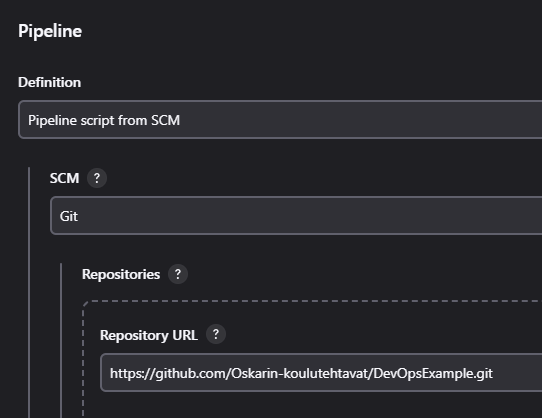

# Yksinkertainen DevOps Pipeline eli Java-koodisi GitHubista Dockeriin Jenkinsillä

Tässä esimerkissä kuvaillaan askeleet GitHubissa sijaitsevan Java projektin testien suorituksen ja koonnin Mavenillä, laadun tarkistuksen SonarQubella, ja Docker "kuvan" luomisen Jenkinsillä. Java, Jenkins ja Docker asennuksiin löytyy scriptit. Jos suoritat scriptit, voit jättää välistä ohjeiden asennus vaiheet.

Ohjeessa käytetty Ubuntu 22.04 LTS.

Jos käytät WSL, `systemctl` komennot eivät toimi ennen kun luot tiedoston `/etc/wsl.conf` seuraavalla sisällöllä ja käynnistät WSL uudestaan.

```conf
[boot]
systemd=true
```

## Esivalmistelut

Päivitetään asennetut ohjelmat ja varmistetaan että tarvittavat ohjelmat on asennettu:

```sh
sudo apt update && sudo apt upgrade -y
sudo apt install wget curl zip ca-certificates fontconfig -y
```

## Java Asennus

Jenkinsin suosittelema veriso Javaa asentuu yksinkertaisesti komennolla

```sh
sudo apt install openjdk-17-jre -y
```

Tämän jälkeen lisää Javan sijainti `JAVA_HOME` muuttujaan ja lisää `bin` kansio `PATH` muuttujaan. Se tapahtuu lisäämällä `/etc/profile` tiedostoon seuraavat rivit. Komento `readlink -f /usr/bin/java | sed "s:/bin/java::"` koostuu kahdesta osasta. Ensimmäinen komento `readlink -f /usr/bin/java` katsoo mihin sijaintiin `/usr/bin/java` on linkki, ja `|` ohjaa sijainnin toiseen komentoon `sed "s:/bin/java::"`, joka positaa lopusta `/bin/java`.

```sh
export JAVA_HOME=$(readlink -f /usr/bin/java | sed "s:/bin/java::")
export PATH=$PATH:$JAVA_HOME/bin
```

Tallennuksen jälkeen suorita `/etc/profile` komennolla

```sh
. /etc/profile
```

## Jenkins

### Jenkinsin Asennus

Lisätään Jenkinsin GPG avain:

```sh
sudo wget -O /usr/share/keyrings/jenkins-keyring.asc \
  https://pkg.jenkins.io/debian-stable/jenkins.io-2023.key
```

Lisätään Jenkinsin arkisto Apt lähteeksi:

```sh
echo "deb [signed-by=/usr/share/keyrings/jenkins-keyring.asc]" \
  https://pkg.jenkins.io/debian-stable binary/ | sudo tee \
  /etc/apt/sources.list.d/jenkins.list > /dev/null
```

Asennetaan Jenkins:

```sh
sudo apt update
sudo apt install jenkins
```

### Jenkinsin Käyttämän Portin Vaihto ja Avaus Palomuurista

Jenkins käyttää oletuksena porttia `8080`. Portin voi vaihtaa tiedostosta `/lib/systemd/system/jenkins.service` ja etsimällä rivin `Environment="JENKINS_PORT=`... ja vaihtamalla portin. Muutokset ladataan seuraavalla komennolla.

```sh
sudo systemctl daemon-reload
```

Portti pitää avata palomuurista jotta voidaan yhdistää Jenkinsin web käyttöliittymään. Se thdään komennolla

```sh
sudo ufw allow 8080
```

### Jenkinsin Käyttöönotto

Jenkinsin web käyttöliittymä löytyy oletuksena portista `8080`. Ensimmäisen kirjautumiskerran admin salasanan voi tarkistaa helpoiten komennolla

```sh
sudo cat /var/lib/jenkins/secrets/initialAdminPassword
```



Kirjautumisen jälkeen suorita Jenkinsin alkutoiminnot. Jenkinsin suosittelemat laajennukset ovat hyvät. Käyttäjän luomisen ja Jenkins URL asettamisen voi ohittaa. Nyt olet valmis aloittamaan Jenkinsin käytön.

## Jenkins Pipeline Maven Integration

Asennetaan `Pipeline Maven Integration` laajennus Jenkinsiin. Laajennuksien asennus löytyy **Manage Jenkins > Plugins > Available Plugins**



Etsi laajennus saatavilla olevista laajennuksista ja valitse se asennettavaksi.



Laajennukset asentuvat `Install` napista.


Muokkaa jenkinsin työkaluja **Manage Jenkins > Tools**



Lisää automaattisesti asentuva Maven. Nimeä käytetään myöhemmin Jenkinsfile.



## Docker

### Dockerin Asennus

Lisätään Dockerin GPG avain:

```sh
sudo wget -O /etc/apt/keyrings/docker.asc \
  https://download.docker.com/linux/ubuntu/gpg
```

Lisätään Dockerin arkisto Apt lähteeksi:

```sh
echo \
  "deb [arch=$(dpkg --print-architecture) signed-by=/etc/apt/keyrings/docker.asc] \
  https://download.docker.com/linux/ubuntu \
  $(. /etc/os-release && echo "$VERSION_CODENAME") stable" | \
  sudo tee /etc/apt/sources.list.d/docker.list > /dev/null
```

Lopuiksi päivitetään Apt ja asennetaan Dockerin ohjelmat:

```sh
sudo apt update
sudo apt install docker-ce docker-ce-cli containerd.io \
  docker-buildx-plugin docker-compose-plugin -y
```

### Asennuksen Jälkeen

Luo ryhmä `docker`, lisää käyttäjä `jenkins` siihen, ja lopuksi päivitä ryhmä.

```sh
sudo groupadd docker
sudo usermod -aG docker jenkins
```

Käynnistä palvelin uudelleen.

Aloita Docker daemon komennolla

```sh
sudo systemctl start docker
```

Docker kuvia voi kopioida ja uudelleen käyttöönottaa seuraavilla komennoilla.

```sh
docker save -o fedora-all.tar fedora
docker load -i fedora-all.tar
```

## Jenkins Pipeline

Repossa tulee Jenkinsfile, joka määrittelee pipelinen, sekä pipelinen tarvitsema dockerfile.

Käytä Jenkinsfile aina `'` merkkijonoihin, sillä `"` hajottaa pipelinen, eikä se osaa kertoa miksi. `"` käyttö merkkijonojen sisällä toimii.

Luodaan uusi pipeline Jenkinsissä





Lisää pipeline script from SCM ja aseta projektisi git url.



Nyt voit ajaa pipeline buildin.


## Seuraavaksi

Ohjeet SonarQuben asennukseen ja käyttöönottoon Jenkinsissä löytyy [täältä](/sonarqube.md).

Voit halutessasi jatkaa [lisäohjeisiin](lisäohjeet.md), jossa käsitellään virtuaalipalvelimia, SSH avainpareja ja GitHub Webhook käyttöä Jenkinsin automatisointiin.

## Lähteet

- [**Jenkins User Handbook**: Installing on Linux](https://www.jenkins.io/doc/book/installing/linux/)
- [**docker.docs**: Install Docker Engine on Ubuntu](https://docs.docker.com/engine/install/ubuntu/)
- [**docker.docs**: Linux post-installation steps for Docker Engine](https://docs.docker.com/engine/install/linux-postinstall)
- [**docker.docs**: docker image save](https://docs.docker.com/reference/cli/docker/image/save/)
- [**docker.docs**: docker image load](https://docs.docker.com/reference/cli/docker/image/load/)
- [**StackOverflow**: How to set JAVA_HOME in Linux for all users](https://stackoverflow.com/questions/24641536/how-to-set-java-home-in-linux-for-all-users)
- [**StackOverflow**: How to reload profile settings without logging out and back in again?](https://stackoverflow.com/questions/2518127/how-to-reload-bashrc-settings-without-logging-out-and-back-in-again)
- [**Microsoft Learn**: Use systemd to manage Linux services with WSL](https://learn.microsoft.com/en-us/windows/wsl/systemd)
- [**ChatGPT** 🙏](https://chat.openai.com/)

---

Tehnyt Oskari Pahkala 2024
